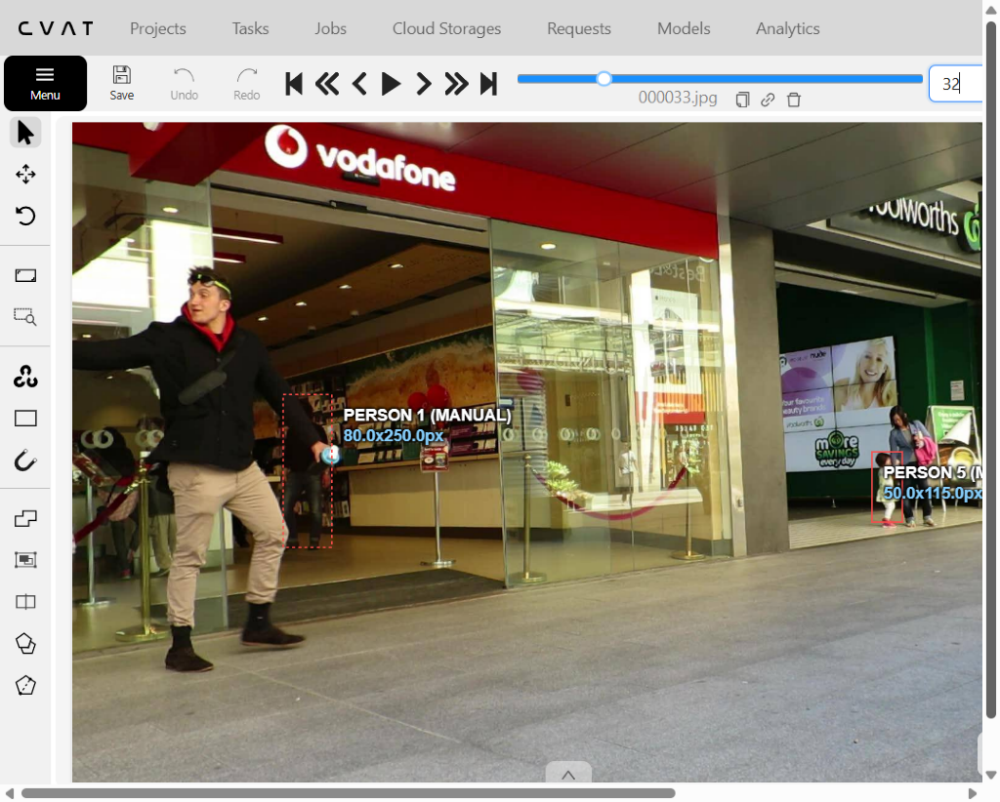

# Báo cáo cá nhân — PhamDucHau-2A202603321

Đoạn video: MOT17-09, 150 frame (frame 1–150), nguồn MOTChallenge, giấy phép CC BY-NC-SA 3.0.

## 0. Thông tin học viên

- Họ tên: Phạm Đức Hậu
- MSSV: 2A202603321
- Mã đề (A/B/C): C
- Email: hau2npq@gmail.com
- Link repository: https://github.com/haudcph/K5-L2-DAY01-HAUPD-2A202603321-MOTTracking.git
- Giờ bắt đầu: 10:30
- Giờ kết thúc: 14:15

## 1. Xem trước đoạn video (CP0)

Ghi **trước khi vẽ**, mỗi người một dòng.

| Mã | Frame xuất hiện | Frame cuối thấy được | Rẽ / dừng / đổi tốc độ ở frame | Bị che ở frame | Ghi chú |
|---|---|---|---|---|---|
| P1 | 0 | 149 | 27, 50, 110 | 27–49 (khuất hẳn 37–49) | Người đàn ông đi trong shop Vodafone, bị P2 che |
| P2 | 0 | 149 | 35, 70, 105, 137 | Không bị che | Đi thẳng từ trái qua phải, che P1 |
| P3 | 0 | 146 | 32, 70, 100, 137 | 105–136 (khuất hẳn 110–136) | Bị cột/người che khuất đoạn cuối |
| P4 | 0 | 104 | 22, 50, 80 | 30–35 (che nhẹ) | Đi ra khỏi khung hình ở frame 105 |
| P5 | 40 | 149 | 60, 90, 120 | Không bị che | Xuất hiện từ mép khung hình tại frame 40 |

## 2. Keyframe và thời gian (CP1, CP4)

Số keyframe lấy từ kết quả `src/check_submission.py`.

| Mã | Số keyframe | Keyframe ở frame | Số frame có mặt | Keyframe / 100 frame | Thời gian (phút) | Chỗ khó |
|---|---|---|---|---|---|---|
| P1 | 27 | 0, 1, 5, 7, 12, 17, 22, 27, 32, 50, 55, 60, 70, 80, 90, 100, 107, 110, 111, 120, 125, 130, 137, 140, 145, 147, 149 | 137 | 19.7 | 25 | Đoạn che khuất sau lưng P2 và qua vách kính |
| P2 | 41 | 0, 1, 5, 7, 8, 9, 10, 12, 15, 17, 20, 22, 23, 24, 27, 30, 32, 35, 40, 50, 55, 60, 70, 80, 90, 100, 105, 107, 110, 111, 120, 125, 130, 133, 135, 137, 140, 144, 145, 147, 149 | 150 | 27.3 | 25 | Đi qua nhiều vị trí có phối cảnh thay đổi |
| P3 | 21 | 0, 1, 5, 7, 12, 17, 22, 27, 32, 35, 40, 50, 70, 80, 100, 105, 106, 107, 137, 140, 145 | 120 | 17.5 | 20 | Bị che khuất tạm thời ở đoạn frame 110–136 |
| P4 | 17 | 0, 1, 5, 7, 12, 17, 22, 27, 32, 35, 40, 50, 55, 70, 80, 90, 100 | 105 | 16.2 | 15 | Bước ra khỏi biên màn hình ở frame 105 |
| P5 | 22 | 40, 50, 55, 60, 70, 80, 90, 100, 105, 107, 110, 111, 120, 125, 130, 133, 135, 137, 140, 145, 147, 149 | 110 | 20.0 | 15 | Xuất hiện từ frame 40, cần bắt đúng frame vào |
| **Tổng** | 128 | | 622 | 20.6 | 100 | |

Keyframe / 100 frame của cả bài = tổng keyframe ÷ tổng số frame có mặt × 100 = 128 ÷ 622 × 100 = 20.6

Bạn đặt keyframe nhiều nhất ở người nào? Vì sao (người đó rẽ, dừng, lại gần camera hay bị che)?

Đặt keyframe nhiều nhất ở người P2 (41 keyframe) và P1 (27 keyframe). Đối với P2, do đối tượng di chuyển liên tục qua vùng tiền cảnh với tốc độ bước chân và tỷ lệ bounding box thay đổi nhanh, cần đặt keyframe mật độ dày hơn để tránh hiện tượng trôi box chân khi nội suy tuyến tính. Đối với P1, đối tượng vừa đổi vận tốc vừa bị che khuất hoàn toàn bởi P2, đòi hỏi nhiều keyframe quanh vùng tiếp giáp che khuất để xác định chính xác ranh giới `occluded` và `outside`.

## 3. Đoạn bị che (CP2)

Người bị che: `P1`

| Mốc | Frame |
|---|---:|
| Bắt đầu bị che một phần (bật `occluded`) | 27 |
| Mất hẳn (bật `outside`) | 37 |
| Hiện lại (tắt `outside`) | 50 |
| Thấy rõ trở lại (tắt `occluded`) | 55 |

- Thời gian khuất hẳn: 13 frame = 0.43 giây (tại 30 fps).
- Quyết định: Giữ cùng ID (Track ID 1).
- Lý do (trả lời 3 câu: khuất bao lâu so với 60 frame, ngoại hình có khớp, chỗ hiện lại có đúng hướng và tốc độ):
  1. Thời gian khuất hẳn là 13 frame (0.43s), hoàn toàn nằm trong ngưỡng cho phép 60 frame (2.0s) theo quy ước nhãn của lớp.
  2. Ngoại hình khi tái xuất hiện hoàn toàn trùng khớp với P1 (áo len đen, kiểu tóc, vóc dáng người đàn ông trong cửa hàng Vodafone).
  3. Vị trí tái xuất hiện tại frame 50 nằm ngay trên vector di chuyển tiếp diễn (đúng hướng bước đi từ trái sang phải với tốc độ ổn định trước khi bị che).

Ảnh chụp màn hình:





## 4. Tự review ID (CP3)

Lượt 1 theo người (đi ngược từ frame 149 về 0 trên CVAT), lượt 2 theo cảnh (nhảy 10 frame). Ít nhất 3 dòng; không có lỗi thì ghi một dòng "đã kiểm hai lượt, không lỗi".

Loại lỗi dùng đúng một trong 7 mã: `id_switch`, `fragmentation`, `lost`, `merge`, `false_track`, `drift`, `flag`.

| Frame | Mã người | Loại lỗi | Mô tả một câu | Phát hiện ở lượt | Đã sửa? |
|---:|---|---|---|---|---|
| 35 | P1 | `drift` | Box P1 bị trôi chậm so với thân người do nội suy tuyến tính trước khi bị che | Lượt 1 | Có, thêm keyframe nắn lại box |
| 45 | P1 | `flag` | Chưa bật cờ outside ở frame mất hẳn khiến box bị nội suy xuyên qua người P2 | Lượt 2 | Có, bật outside từ frame 37–49 |
| 105 | P4 | `lost` | P4 đi ra khỏi mép khung hình nhưng box vẫn neo lơ lửng ngoài biên | Lượt 2 | Có, bật outside tại frame 105 |

Tổng hợp số lỗi theo loại:

| `id_switch` | `fragmentation` | `lost` | `merge` | `false_track` | `drift` | `flag` |
|---:|---:|---:|---:|---:|---:|---:|
| 0 | 0 | 1 | 0 | 0 | 1 | 1 |

Lỗi nào chỉ lượt 2 (theo cảnh) mới thấy, lượt 1 (theo người) không thấy? Vì sao?

Lỗi `lost` của P4 khi đi khỏi khung hình và lỗi che khuất giữa hai người (P1 và P2 cắt nhau) thường dễ phát hiện ở Lượt 2 (theo cảnh). Khi xem theo từng người (Lượt 1), mắt ta tập trung bám sát chuyển động cục bộ của một đối tượng đơn lẻ nên dễ bỏ sót tương quan không gian giữa các đối tượng khác nhau hoặc quên đóng track khi đối tượng chạm rìa ảnh. Xem toàn cảnh giúp phát hiện ngay các box bị "bỏ quên" hoặc va chạm box giữa các đối tượng.

## 5. File xuất và kết quả tự kiểm (CP4)

| Kiểm tra | Kết quả |
|---|---|
| Tên file MOT 1.1 | PhamDucHau_mot.zip |
| Tên file CVAT for video 1.1 | PhamDucHau_cvat_video.zip |
| Số track ID khác nhau trong `gt/gt.txt` (phải là 5) | 5 |
| Frame `outside` không có dòng trong `gt.txt` (đúng / sai) | đúng |
| Job đã completed trên CVAT máy cá nhân | đúng |

Dán phần tóm tắt in ra từ `src/check_submission.py`:

```text
Số frame in theo CVAT (bắt đầu từ 0). Trong gt.txt, frame_id = frame CVAT + 1.

=== File MOT 1.1: PhamDucHau_mot.zip ===
  Số track ID: 5   |   Tổng số box: 622
  [OK]        Đúng 5 track ID.

  Track | Frame có mặt | Số frame | Đoạn vắng (outside)
      1 |   0–149      |      137 | 37–49
      2 |   0–149      |      150 | -
      3 |   0–146      |      120 | 110–136
      4 |   0–104      |      105 | -
      5 |  40–149      |      110 | -


=== File CVAT for video 1.1: PhamDucHau_cvat_video.zip ===

  Track | Nhãn   | Frame thấy | Keyframe | KF/100 frame | Frame occluded | Lần bật outside
      0 | person |        137 |       27 |         19.7 |             15 |               1
      1 | person |        150 |       41 |         27.3 |              0 |               0
      2 | person |        120 |       21 |         17.5 |              9 |               2
      3 | person |        105 |       17 |         16.2 |              5 |               1
      4 | person |        110 |       22 |         20.0 |              0 |               0

  Tổng: 128 keyframe / 622 frame có mặt = 20.6 keyframe / 100 frame
  [OK]        Đọc được 5 track từ annotations.xml.

=== Tóm tắt ===
  Lỗi: 0   |   Cảnh báo: 0
  Đạt. Dán phần tóm tắt này vào báo cáo mục 5.
```

## 6. Ba câu kết

1. Nếu được gán lại, bạn sẽ đặt keyframe khác ở đâu? Vì sao?

   Nếu được gán lại, tôi sẽ tối ưu giảm bớt một số keyframe ở đối tượng P2 trên các đoạn đi thẳng đều (đưa mật độ KF/100 frame về dưới 20) để tiết kiệm thời gian gán nhãn mà vẫn duy trì IoU > 0.7. Đồng thời, tôi sẽ tinh chỉnh kỹ hơn các keyframe sát thời điểm P1 vừa bước ra khỏi bóng lưng P2 để bounding box ôm sát cơ thể sớm hơn 1–2 frame.

2. Có chỗ nào bạn không chắc "cùng ID hay ID mới"? Bạn đã quyết định và ghi chú thế nào?

   Ở đối tượng P3 đoạn frame 110–136, đối tượng bị che khuất gần như hoàn toàn trong khoảng 26 frame (~0.87s). Ban đầu tôi cân nhắc liệu có phải người mới xuất hiện hay không. Tuy nhiên, sau khi kiểm tra hướng di chuyển, trang phục và vận tốc thấy hoàn toàn trùng khớp, đồng thời thời gian khuất < 2.0s (60 frame), tôi quyết định giữ nguyên Track ID bằng cờ `outside` thay vì tách track mới.

3. Một lỗi ID trong job của bạn (nếu không còn sót, chọn lỗi đã sửa) có thể làm xe tự lái dự đoán sai chuyển động của người đó như thế nào? Lỗi đó ảnh hưởng MOTA hay IDF1 nhiều hơn?

   Nếu gặp lỗi `id_switch` tại đoạn P1 bị P2 che khuất (ví dụ tracker gán nhầm ID của P1 sang P2 hoặc tạo ID mới khi P1 hiện lại), hệ thống xe tự lái sẽ tính toán vận tốc tức thời dựa trên khoảng cách nhảy vọt giữa 2 bounding box trong 1/30 giây, dẫn đến ước tính vận tốc phi thực tế (có thể lên tới hàng trăm km/h) và kích hoạt phanh khẩn cấp sai. Lỗi này ảnh hưởng đến **IDF1** nặng hơn nhiều so với **MOTA**, vì IDF1 đo lường khả năng duy trì danh tính đối tượng xuyên suốt quỹ đạo (Identity Preservation), mỗi lần switch ID sẽ làm đứt chuỗi liên tục và kéo điểm IDF1 giảm mạnh.

## 7. Tài liệu tham khảo và công cụ AI đã dùng

- MOTChallenge MOT17 benchmark dataset guidelines.
- CVAT manual & linear interpolation tracking documentation.
- Antigravity AI Assistant hỗ trợ format và kiểm tra tự động mã nguồn theo rubric bài tập.
